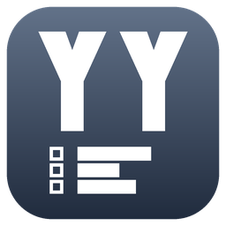

# YYproject

タスク・課題・進捗をSQLiteまたはPostgreSQLで管理するRustアプリです。Windows GUI (`yyprojectw`) と、Windows／Linux向けstdio MCPサーバー (`yyproject`) を提供します。



カンバン、ガント、タスク／課題一覧、依存ネットワーク、バーンダウン／バーンアップ、カテゴリ・担当者・休日マスタに対応します。優先度・重大度・レビュー、課題と対応タスクの関連付け、工数算入の設定、項目の保管・復元にも対応します。GUIとAIは同じモデルを使用し、更新競合を検出します。親子・孫タスク、3階層カテゴリ、セルの範囲コピー・編集・行移動、列の絞り込み・全文検索、4段ガント・稲妻線・マイルストーン、選択列のCSV出力に対応します。マスタの直接編集、複数行の属性一括変更・実績完了日、列幅・行高の境界ドラッグ、日次チャートと依存系統の強調にも対応します。SQLiteとUDEV Gothicフォントは同梱されます。

- [PostgreSQL・Docker Compose・双方向移行](docs/user/postgresql.md)
- [Jira用CSV出力と取り込み手順](docs/user/jira-csv.md)
- [Streamable HTTPサーバー・PAT認証](docs/user/mcp-http.md)
- [同梱デモDBと操作例](demo/README.md)
- [使い方](docs/user/yyproject.md) / [同梱ヘルプとMCP設定](help/help.md)
- [開発・ビルド・検証](docs/developer/yyproject.md)
- [検討経緯・検証記録](docs/history/README.md)

```sh
cargo build --workspace --release --locked
# Windows GUI
./target/release/yyprojectw.exe
# Windows / Linux MCP (Windowsでは.exeを付ける)
./target/release/yyproject --mcp projects.sqlite3
```

`demo/yyproject-demo.sqlite3` にYYシリーズの3案件・90項目を同梱しています。新しい日付のデモDBは `yyproject --init-demo NEW_DATABASE` で作成できます。WindowsではMSVCとWindows SDK、LinuxではCコンパイラが必要です。[開発手順](docs/developer/yyproject.md)を参照してください。

本体のライセンスは [GPL-3.0-or-later](COPYING) です。WebView2との結合に関する[追加の許可](COPYING.EXCEPTION)と[素材・依存の案内](NOTICE.md)も参照してください。
