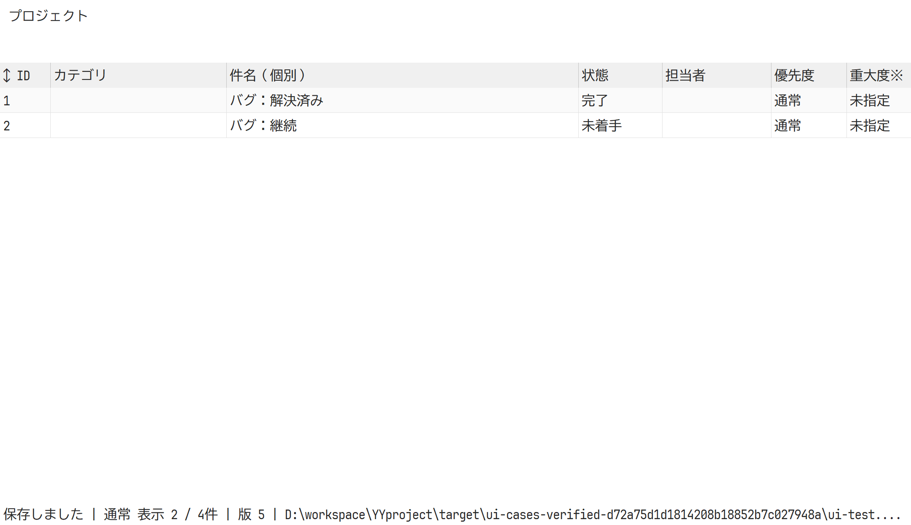
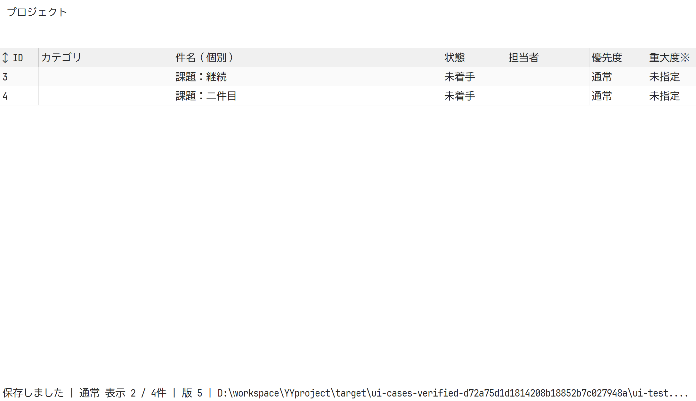
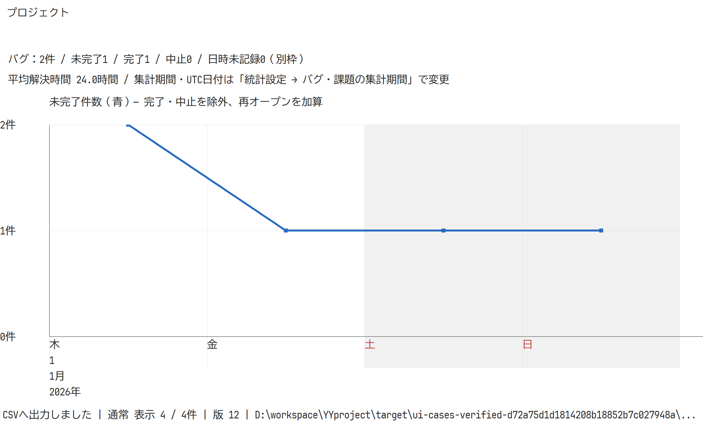
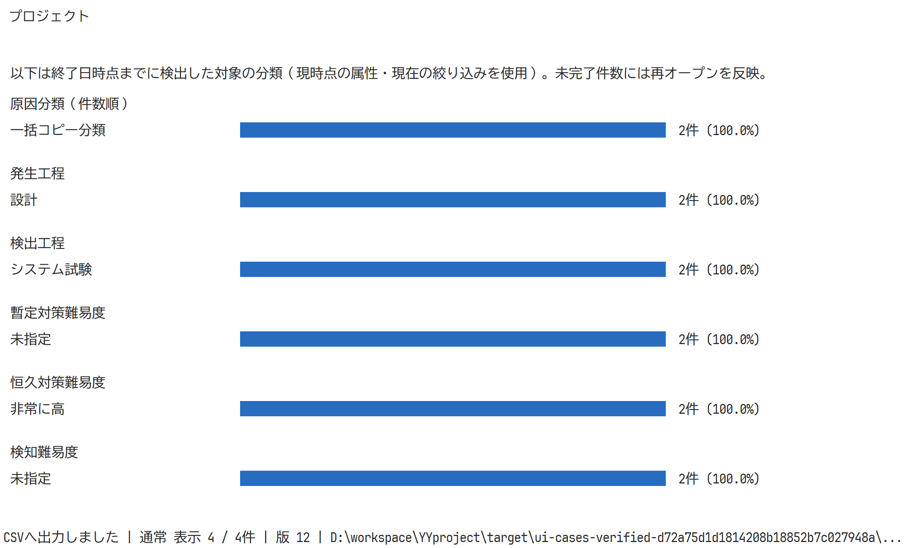
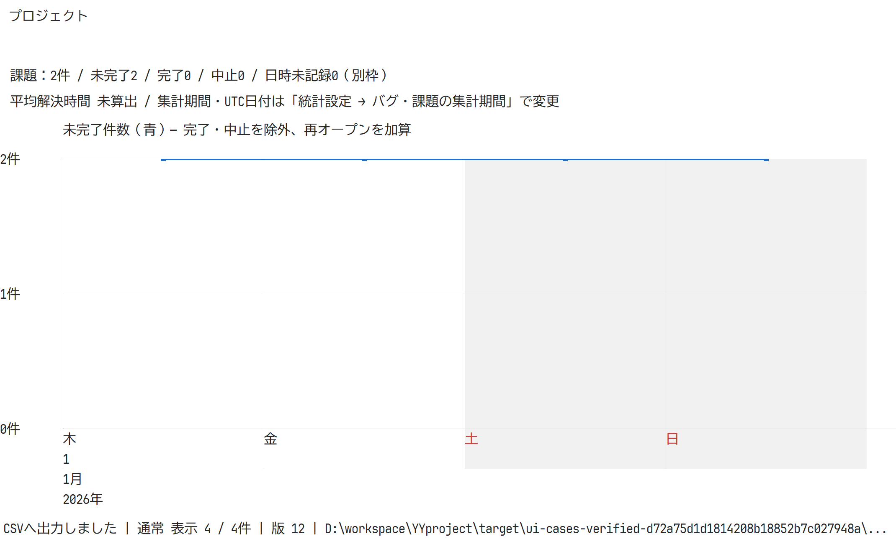

# バグ・課題の専用管理と統計（2026-10-27）

タスクとは別にバグ一覧・バグ統計を追加し、既存の課題を専用の詳細フォームと分析列へ拡張した。ID・既存属性・関連タスクを保持する。工程・原因・暫定／恒久対策・3種類の難易度・10種類の日時、状態遷移履歴を保存する。件数の収束バーンダウン、原因・工程・難易度の6分類棒グラフと割合、平均解決時間を追加した。

両一覧はタスク一覧のgrid/sizing/bulk/CSVを共用し、セル編集・範囲コピー・Ctrl+D・1セル貼り付けの範囲展開・複数行属性変更・列の値のフィルタ・幅と行高の変更・行移動を利用する。専用のCSVメニューでは出力列と条件を選べる。日次チャートはタスクと同じ描画処理を件数単位で利用し、日次格子・週ごとの日の数字・曜日/日/月/年・休日背景・太線を共通にした。

DB形式5。SQLite1〜4とPostgreSQL3〜4を読み、正常更新・移送時だけ5へ更新する。トランザクション・版競合・監査・循環検証を維持する。検出日時のない旧課題は日付を推測せず別枠に表示する。MCPの読み取り専用case_statisticsを追加し、stdioとPAT HTTPで同じ結果を返す。

## 検証結果

- Windows: fmt、Clippy（-D warnings）、全31テスト、リリースビルドが成功。追加3テストで、日別の検出・完了・中止・再オープン、範囲前の繰越、平均解決時間、状態履歴の保持、タイムゾーン変換、不正日時の原子性、競合、CSV、SQLite書き出し、旧課題の未記録扱いを検証した。
- Linux: Docker rust:1.92-bookwormでfmt・Clippy・全30テスト・ビルドが成功。LinuxでGUI検証は行っていない。
- WindowsとLinuxの実stdio MCP: tools/test_mcp.pyからtest_cases.pyを実行し、専用DBでバグ・課題の分離、全調査項目、日次集計、絞り込み、読み取り専用、日時不正の無更新を確認した。
- WindowsとLinuxのPAT HTTP: tools/test_http.pyで、書き込みユーザーによるバグ登録と読み取り専用ユーザーの統計取得に成功した。
- 両OSの実PostgreSQL: test_postgres.pyとtest_http.pyで、調査属性と状態履歴を含むSQLite往復移行・監査・競合・無更新・PAT HTTPに成功した。
- Windows GUI: 専用SQLiteと専用PostgreSQL、所有ウィンドウ、実DPI192・実クライアント・スクロール位置で全11画面と詳細フォームを確認した。両一覧の分離、F2保存、同列コピー・1セル貼り付け、一括属性変更、列/行境界の寸法変更、対策予定・完了日時を含む一括変更の属性設定、専用CSVメニューと出力内容、原因フィルタ、日次集計・棒グラフとスクロールを検証した。試験待ちは期限付きの実状態で判定し、固定sleepを使用していない。所有プロセスは60秒の期限で終了確認・回収した。
- SQLite GUIログ: target/ui-cases-verified-d72a75d1d1814208b18852b7c027948a/ui-smoke.txt。
- PostgreSQL GUIログ: target/ui-cases-postgres-764bf321fa0349199bdf76064f82be57/ui-smoke.txt。
- 今回作成した専用DB yyproject_cases_win_20261027、yyproject_cases_gui_20261027、yyproject_cases_linux_20261027は試験後に削除した。利用中のyyproject DB、既存デモDB、実PAT・接続設定は変更していない。

利用中のデモDBとは別に、Git管理版のデモDBを使用した検証用ソースコピーで全テストを実行した。試験の除外や警告allowは追加していない。依存の固定SHAは変更していない。GitHub CIは今回の未コミット変更について未実行。

## 描画記録

本番キャンバスの画像。ネイティブのタブや詳細フォームの子コントロールは画像に含まれず、上記の所有ウィンドウ試験で配置を確認した。

