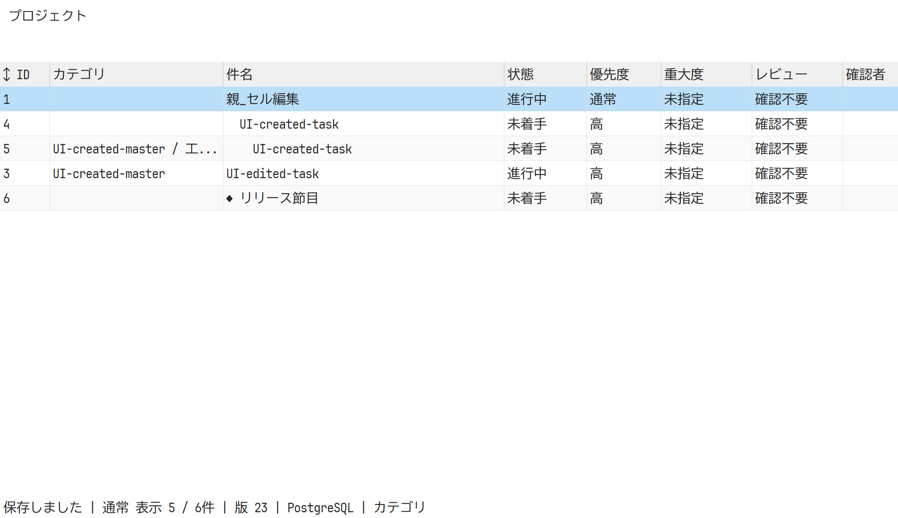
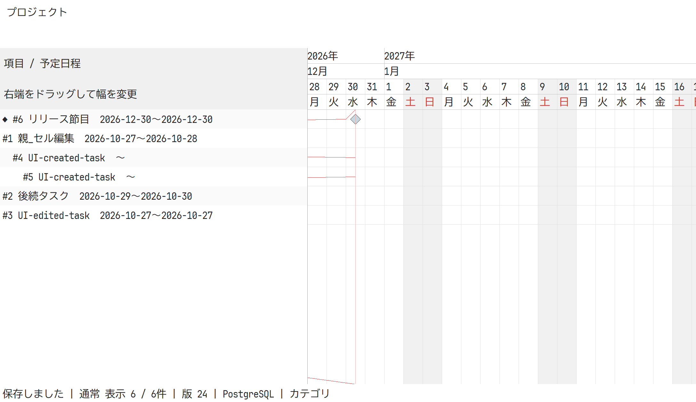

# 階層・グリッド・ガント・CSV・PostgreSQL（2026-10-27）

## 実装範囲

- 一覧の右クリックから子タスクを作成し、同じ操作で孫を作成。親変更、循環・欠損親の拒否、子孫ごとの行移動。
- カテゴリを件名の直前へ移し、3階層のマスタと各階層の列を追加。
- yysheetの操作実装を参照し、セル選択・範囲コピー・既存行へのTSV貼り付け・F2/Enter/Esc/Tab編集・Deleteによるセル初期化を追加。必須項目や業務条件に違反する一括変更は全部ロールバック。
- 列見出しの右クリックから値で絞り込み。Ctrl+Fで説明・メモ・マスタ名も含む全文検索。
- ガントを年・月・日・曜日の4段とし、起点・名前列のドラッグ幅変更・日幅・稲妻線と基準日を設定。マイルストーンは同日・工数0・期間0で、菱形表示。
- GUIのJSON出力を、列を選択して絞り込めるUTF-8 BOM付きCSVへ変更。
- Jira Cloud用CSVを追加。Summary・Issue Type・Issue ID・Parentを必須にし、追加列・タイプ名・2／3階層を指定する。フィルター一致項目の祖先を含め、Jiraの階層順に出力する。深すぎる階層と不適合の件名は出力前に拒否する。
- PostgreSQL接続とDocker Composeを追加。SQLiteからの移行、監査全件を含むSQLiteへの書き出しを実装。空の移行先と新規ファイルに限定し、既存データを上書きしない。

固定Git依存のSHAは維持し、yyeditorのUI本体・yy-encoding本体は複製していない。PostgreSQL/TLS依存をCargo.lockへ追加し、追加依存のライセンス通知を同梱した。.envの接続秘密はGitと配布物に含めない。

## 検証記録

Windows: リリースビルドを対象に以下を確認した。既存target/release/yyprojectw.exeをアクセス拒否で置換できなかったため、target/kanban-buildへ別出力し、既存プロセス・ファイルには触れていない。

- cargo fmt --all -- --check: 成功。
- cargo clippy --workspace --all-targets --locked -- -D warnings: 成功。
- cargo test --workspace --locked: Jira追加後の最終版で21件成功、除外・ignoreなし。
- cargo build --workspace --release --locked --target-dir target/kanban-build: 成功。
- tools/test_mcp.py: 実stdio・Unicode永続化・監査・版競合・読み取り専用・保管復元を確認。
- tools/test_postgres.py: Composeの専用DBで移行、2接続が同じ版から競合更新（1件だけ成功）、読み取り専用、バッチ失敗時の無更新、空でない移行先の拒否、100件を超える監査の保持、SQLiteへの書き戻し、ID採番継続を確認。
- tools/validate_operations.py: 3案件・90項目の従来運用シナリオを確認。既存の対応10件・未対応2件（過去の明示captureなど）は従来の検証項目であり、本変更の試験除外ではない。出力はtarget/operations-features-windows。
- yyprojectw --ui-smoke-test NEW_DIRECTORY: SQLiteモードで終了コード0。
- yyprojectw --ui-smoke-postgres NEW_DIRECTORY: 空の専用PostgreSQL DBで終了コード0。別接続からの更新の再読込、ネイティブフォーム、子・孫タスク、3階層カテゴリ、F2/Enterのセル保存、矩形TSV、Deleteによるセル初期化（保管しないこと）、不正貼り付けの原子性、見出しの右クリック、全文検索、行ドラッグ、ガント設定・幅ドラッグ、マイルストーン、列選択と検索を併用したCSVを確認。
- 両GUI試験は所有プロセスを期限60秒で終了確認・回収。実DPI192、論理1100×700／640×480に対応する実ウィンドウと、追加の640×480物理サイズのカンバンを使用。実クライアント領域・スクロール・ヒット領域を使い、固定sleepによる完了判定は行っていない。

GUI記録:

- SQLite（Jira追加後の最終版）: target/ui-jira-release-sqlite-5f34f5a917bc4b7b95abd5733db630d6/ui-smoke.txt
- PostgreSQL（Jira追加後の最終版）: target/ui-jira-release-postgres-dbbfb3199855463b9d448f252696e094/ui-smoke.txt
- 両モードでJira出力フォームを実行し、孫だけに一致する検索から親・子・孫が出力されること、タイプ・親ID・説明の改行が保持されることを確認。core試験では通常のBugを含む階層順、2階層への不適合、4階層の拒否、列選択、不正なタイプ名、件名長も確認。

Linux: Dockerのrust:1.92-bookwormでfmt、Clippy、21件のテスト、ビルド、実stdio MCPが最終版で成功。90項目の運用、同じComposeへのPostgreSQL実接続・競合・SQLite往復移行もJira追加前に成功。実行ファイルはtarget/linux-validation/debug/yyproject。LinuxではGUIは実行・検証していない。

Compose: yyproject-postgres-1はhealthy、127.0.0.1:15432で稼働。利用者用yyproject DBとは別の検証用DBを使用し、試験終了後に検証用DBだけを削除した。利用者のSQLite・設定・既存のデモDB差分は保持した。.envには生成したローカル接続秘密があり、Git・配布物には含めない。

埋め込みヘルプ、変更文書の相対リンク、ライセンス通知を確認した。配布ZIPはJira追加後に更新し、実行ファイルのバイト一致、ライセンス・ヘルプ・操作説明・Composeの同梱と.envの除外、ZIP全項目のCRCを確認した。CIジョブは追加したが、GitHub CIの実行・最新SHAの成功確認はしていない。別DPIの実機試験、外部ネットワーク上のTLSサーバーへの実接続、実際のJiraへの取り込みは未検証。

## 描画確認

以下は本番キャンバス描画の画像。ネイティブ子コントロール・メニュー・ダイアログは画像に含まれない。ダイアログとメニューは上記の実ウィンドウ試験で別に確認した。

