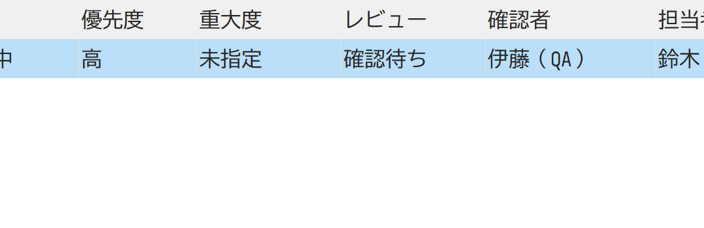
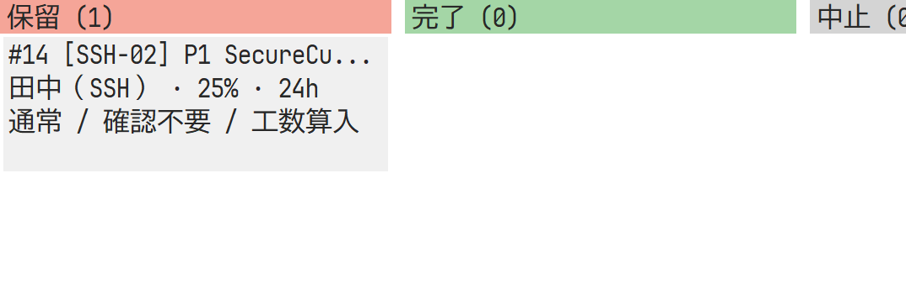

# YYproject 運用課題の第2次改善（2026-10-26）

[第1次改善](yyproject-improvements-2026-10-26.md)の残課題5件から、OPS-07/08/10へ対応した。過去の記録は保持する。対象はYYproject独立リポジトリの未コミットのローカル変更で、GitHub CIやリリース成功を意味しない。

## 実装と確認

| 対象 | 改善 | 確認した動作 |
| --- | --- | --- |
| OPS-07 | 優先度・重大度・レビュー・確認者・確認メモ | GUI編集6タブ、一覧列・カンバン、GUI/MCPの絞り込み。レビューありなら確認者必須、承認・差し戻しは理由必須。確認待ち・差し戻し中の完了を拒否 |
| OPS-08 | 課題から対応タスクへの関連付け、工数算入の設定 | 関連IDの存在・種類・重複を検証。除外した課題の見積もりを8h増やしても総工数は不変。明示的な算入へ変更すると8h増える |
| OPS-10 | 保管前の影響表示・保管済み表示・復元 | プレビューは読取専用。保管で通常表示・現在集計・日程/依存の対象から除くが、レコードと依存関係は保持。同じID・全項目・関係で復元 |

レビューは作業状態から独立した管理項目で、別承認者の認証や権限分離を提供する機能ではない。変更は通常の監査ログに残る。関連付けは依存関係とは別で、工数の重複を自動判定しない。新規GUI課題とデモ課題は工数除外、既存項目とMCP省略時の既定値は算入を維持する。

保管項目の依存関係は、日程計算・完了ゲート・図では無効となる。保管は後続の完了条件にも影響するため、GUIで関係を示して適用を要求する。MCPはプレビューの呼出済みを強制せず、クライアントが版番号を使って確認後に適用する。保管中も参照するマスタを削除できない。復元は新方式で保管した項目が対象で、旧版の完全削除の復元や自動世代整理は含まない。

## DB互換性と性能への配慮

形式1のJSONは新項目の既定値で読み、従来の工数算入を維持する。読み取りや拒否された保存ではuser_versionを変えず、正常な更新と同じトランザクションで形式2へ上げる。旧アプリは形式2を拒否するため、新項目や保管情報を欠落させて保存することを防ぐ。新規DBは形式2。

関連先の種類確認とネットワークの保管判定はマップ・集合を使い、項目ごとの全件検索を避けた。全体の循環参照検証とCAS・監査は維持する。20,000項目・文書16MiBの上限には保管項目も含む。

## 検証結果

Windows Rust 1.99.0とLinux rust:1.99-bookwormコンテナで、書式、全ワークスペース全ターゲットClippy（警告をエラー化）、Rust試験16件（core 12 / app 4）、releaseビルド、実stdio MCPを確認した。旧形式の読取・成功時だけの形式更新、レビュー制約、工数集計、保管・復元と保管中のマスタ参照保護を試験した。

3案件90項目の運用検証は、supported 10 / gap 2。WindowsとLinuxでDB・シナリオSHA-256と判定が一致した。

- [Windows実MCPの証拠](evidence/yyproject-improvements2-windows.json)
- [Linux実MCPの証拠](evidence/yyproject-improvements2-linux.json)
- [GUIの48表示条件と追加操作の証拠](evidence/yyproject-improvements2-ui.json)

Windows GUIは3案件×8表示×2サイズに加え、実編集での優先度保存、レビュー・確認メモの保持、レビュー検索と横スクロール、保管キャンセル/適用、保管後のガント・ネットワーク・チャート、保管済み表示と復元を検証した。編集・検索フォームは全使用ページについてタブ到達性と実クライアント領域内の配置を検査した。睡眠時間で完了扱いにせず、モデルと実描画状態で確認した。

### レビュー列（横スクロール後）

### 保管済みの項目

画像は製品のキャンバス描画を切り出したもの。子コントロールを含まない。編集検証で試験用件名へ変更したタスクを含む。単回の描画時間や表示試験を、対話性能や業務担当者の受入評価の代用にしない。

デモのPRJ-03を確認待ち、SHT-02を差し戻し、ISS-001を最優先・致命的として明示し、確認者・理由と対応タスクを登録した。DBは実Storeで再生成し、整合性とDELETEジャーナルを確認した。操作と形式更新、MCPの項目は利用者文書・同梱ヘルプへ反映した。

## 残る運用課題

- OPS-01: 案件横断の担当者・稼働上限・不在・負荷のモデル。
- OPS-09: 過去進捗の締め、補正理由、訂正承認。

保存ビュー・並べ替え、競合時の入力回復、基準計画と実績日の分離、図のズーム、承認者認証・権限なども未実装。今回の3観点の改善をもって、すべての運用要件を満たしたとは扱わない。
