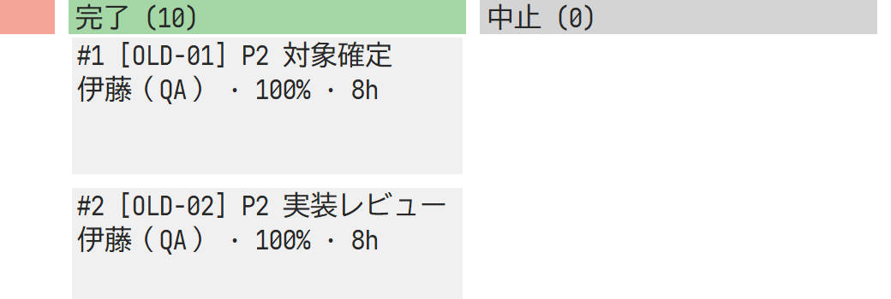

# YYproject 運用課題の第1次改善（2026-10-26）

[初回検証](yyproject-operations-2026-10-26.md)で抽出した誤認・誤操作と進捗会議での探索を改善した。初回記録は変更せず、この時点の結果を別記録とする。対象は独立リポジトリYYprojectのローカル変更。GitHub CI・公開リリースの成功を意味しない。

## 実装した改善

| 課題 | 改善と検証 |
| --- | --- |
| 完了案件のカンバンが空に見える | 起動・案件切替・メニューと実タブの切替で最初の非空列へ移動。件数と列移動メニューを追加。高DPIの狭い画面でも非空カードを検証 |
| OPS-02 担当・未割当・期限超過の発見 | 件名/説明・担当者・カテゴリ・状態・未完了・期限超過・未割当のAND検索。GUIのカンバンと一覧、MCPで判定を共有 |
| OPS-03 再開しても残工数0 | 完了から100%のままの再開を拒否。GUIの状態変更とドラッグでは進捗入力を要求。実ダイアログで40%として再開を確認 |
| OPS-04 保留の先行作業を残して後続を完了 | 新規完了時は先行項目がすべてDoneであることをStoreで検証。中止も未完了扱い。拒否時の版・監査の保持を確認 |
| OPS-05 完了日程の書換え | 開始日と期限があるDone/Cancelledは固定。休日を追加しても完了日程の変更0件を確認 |
| OPS-06 納期を超える再計画 | 読取専用プレビューで版・全差分・超過項目を返す。既定のscheduleは超過時に拒否し、allow_overrun:trueのみ承認として監査へ記録。GUIは読み取り専用差分と適用確認を表示 |

依存による完了拒否はGUI・MCP共通。既に完了している項目の説明編集は可能。再開による後続項目の自動巻き戻しは行わない。日付が欠けている完了・中止項目は再計算時に日付を補う。

## 結果と再現証拠

3案件90項目で、既存の整合性保護2群に改善5件を加えてsupported 7、gap 5。Windows/LinuxのDBとシナリオSHA-256、および各観点の判定は一致した。

- [Windows実MCPの結果](evidence/yyproject-improvements-windows.json)
- [Linux実MCPの結果](evidence/yyproject-improvements-linux.json)
- [GUIの48条件と追加操作の証拠](evidence/yyproject-improvements-ui.json)

Windows/Linuxで書式、全ターゲットClippy（警告をエラー化）、Rust試験13件（core 9 / app 4）、releaseビルド、実stdio MCPを確認。Windows GUIは3案件×8表示×2サイズに加えて、実検索ダイアログ、未割当の描画、解除、完了からの再開、再計画キャンセル・適用と読み取り専用属性を検証した。Linuxはrust:1.99-bookwormコンテナで実行した。WindowsもRust 1.99.0。

プレビューの無変更検証では、保存後に読み直した文書とプレビュー後の文書を厳密比較する。更新応答の浮動小数値とSQLiteのJSON再読込値には微小な表現差があり得るため、未保存の応答を比較元にはしない。プレビューの保存拒否・監査件数・版はRust試験でも確認する。

デモDBは新しい制約で再生成し、課題解決が後続作業の完了より先になるようチェックポイント内のイベント順を修正した。配布用DBは整合性を検査し、DELETEジャーナルへ確定した。

### 完了案件の初期表示

### 高DPI・狭い画面

### 課題を件名で検索

画像は製品のキャンバス描画から取得し、子コントロールを除いた内容領域を切り出した。単回の描画時間を対話性能の評価とは扱わない。極小画面ではスクロールによる詳細確認が必要。

## 残る改善

1. OPS-01: 案件横断のリソース・稼働上限・不在・負荷のモデル。
2. OPS-07: レビュー状態、優先度・重大度・承認者など構造化項目。
3. OPS-08: 課題と対応作業の関連付け、工数の重複集計対策。
4. OPS-09: 過去captureの締め・補正理由・承認。
5. OPS-10: 削除前の影響表示、アーカイブと復元。

保存ビュー・並べ替え、入力中の競合回復、日程基準計画と実績の分離、全体図のズームも残る。納期超過の確認は操作本人によるもので、別承認者の承認フローではない。ガント・ネットワーク・チャートは案件全体を表示し、フィルターで集計対象を変えない。探索時間と業務担当者の理解度は人の受入評価で確認する。
