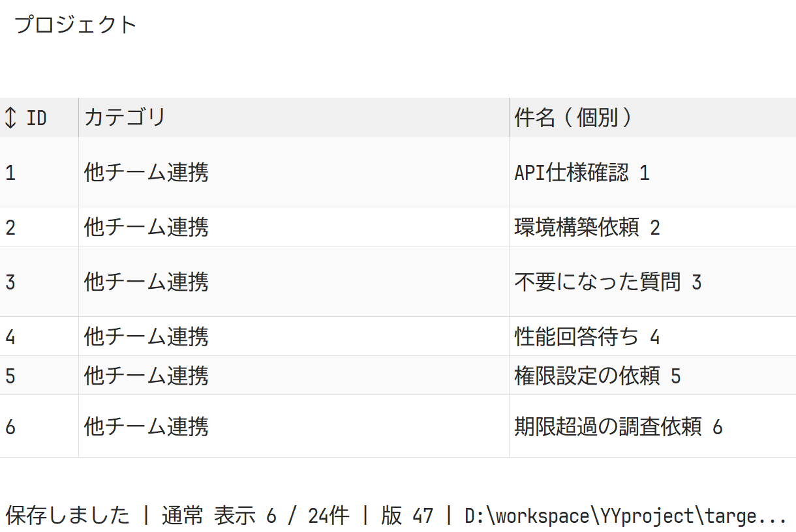
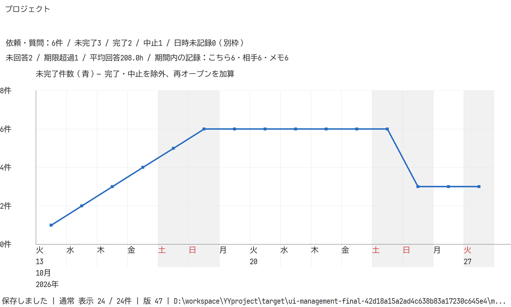
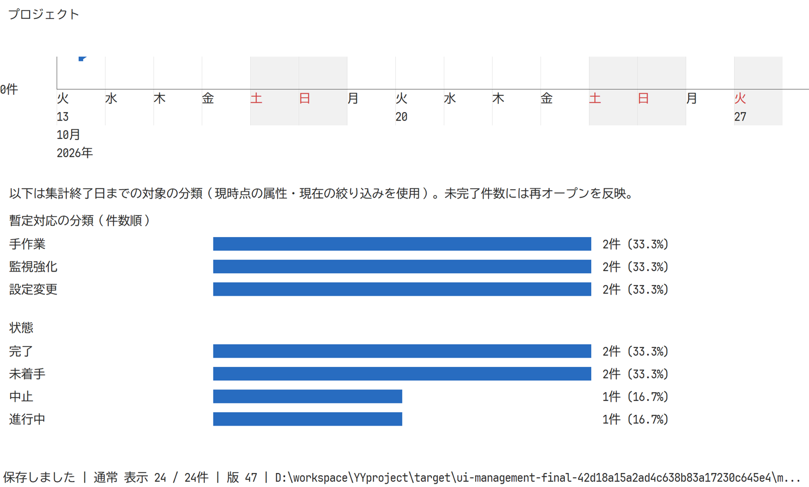

# 依頼・質問／暫定対応と操作性の評価（2026-10-27）

先行するバグ・課題管理は `637072f60d6ca1fb738ece2225e5f7c84656e368` としてmasterへコミット・プッシュ済み。[当該SHAのCI](https://github.com/ykwyuta/YYproject/actions/runs/40421679193)は完了・成功。本記録は、その後の依頼・質問／暫定対応の未コミット実装に対するローカル検証で、GitHub CIや公開リリースの成功を意味しない。実行ファイルとデモのハッシュは[manifest](evidence/management-2026-10-27/manifest.json)に記録する。

## 実装とデモ

依頼・質問は相手チーム・担当者・回答期限と回答／完了日時、手動のやりとり記録を持つ。暫定対応は発生理由、恒久対応の必要条件、実施内容、分類、検知・暫定・恒久日時と恒久予定日を持つ。各専用一覧でセル編集・コピー・複数行属性変更・並べ替え・寸法変更・列フィルター・全文検索・条件付きCSVを提供する。専用の日次件数と分類統計を追加し、タスクと共通の日次格子・休日背景・4段日付を使用する。送受信・通知・添付は提供しない。

拡充デモは4案件114項目、やりとり18件。新しい案件は依頼・質問／暫定対応／バグ／課題を各6件持ち、完了2・中止1・進行中1・未着手2を各種類で再現する。期限超過、回答済み未完了、暫定未実施、恒久対応待ちも含む。[操作シナリオ](../../../demo/management-playbook.md)と `--init-management-demo` で再生成可能。利用者が変更した既存 `demo/yyproject-demo.sqlite3` は更新・コミット・同梱差し替えを行っていない。

## 実行結果

|環境・試験|結果と確認範囲|
|---|---|
|Windows MSVC|fmt、Clippy全workspace/all-targets/警告エラー、Rust試験35件成功|
|Linux rust:1.92-bookworm|同じfmt・Clippy、Rust試験34件成功。GUIの検証には含めない|
|Windows/Linux stdio|実プロセスのinitialize、11ツールの発見、記録CRUD、全属性保存、担当者一括変更、日付・平均時間・日次集計、全文／列検索、行順、保管復元、引用符・複数行CSV、版競合、読み取り専用、失敗時ロールバックが成功|
|Windows/Linux HTTP|実Streamable HTTPとPAT。依頼・暫定登録、記録追加、読み取り専用PATの更新拒否、統計・CSV参照、監査の認証ユーザー固定が成功|
|Windows/Linux PostgreSQL 17|Docker Composeの専用DB。依頼・暫定・やりとりを含むSQLite→PG、PG→SQLiteの全データ・監査往復、MCP全属性・統計、HTTP成功|
|Windows GUI SQLite/PG|専用DB・所有ウィンドウの `--ui-smoke-test`／`--ui-smoke-postgres` が成功。下記の操作性試験を含む|
|従来の運用評価|3案件90項目の実MCPシナリオを再実行。10項目supported、2項目gap。gapを試験合格と数えない|

必須Rust検査は、利用中のデモDBを除く作業ファイルを同期した `target/ui-polish-source` 上で実行した。旧デモだけはHEADの同梱DBを使い、試験や期待値を除外しない。SQLiteの形式5から6は、拒否された保存で版・データ・監査が変わらず、成功時に同一トランザクションで更新されることも試験した。

証跡: [MCP受入結果](evidence/management-2026-10-27/mcp.json)、[Windows MCP](evidence/management-2026-10-27/windows-mcp.txt)、[Windows PG](evidence/management-2026-10-27/windows-postgres.txt)、[Linux検査](evidence/management-2026-10-27/linux.txt)、[Linux全属性PG](evidence/management-2026-10-27/linux-management-fields.txt)、[GUI SQLite](evidence/management-2026-10-27/windows-ui-sqlite.txt)、[GUI PostgreSQL](evidence/management-2026-10-27/windows-ui-postgres.txt)。一時DB・所有プロセスは終了後に回収した。利用者のDB・設定や起動中の `target/release/yyprojectw.exe` は変更していない。

## 操作性の評価

Windowsの実DPIは192。ウィンドウ寸法をDPI換算した1100×700／640×480、実クライアント領域、実スクロール位置からヒット領域を求めた。固定sleepではなく期限付きの状態判定で完了を確認した。

専用フォームの全ページでコントロールの境界・読み取り専用を検証し、4件を実登録。やりとりの複数行本文を実フォームで追加・編集・削除した。両一覧でインライン編集、同列範囲コピー・貼り付け・Ctrl+D相当、一括属性変更、列・行境界のドラッグ、専用CSVメニュー、列値の適用を確認した。拡充デモを両サイズで描画・スクロールし、IDセルへの実マウスメッセージで両一覧の行移動、列見出し右クリックによるフィルターメニューを確認した。

生成した画像を目視し、一覧のカテゴリ・件名、日次格子・休日色・日付、太い折れ線、件数と割合の分類棒グラフを確認した。画像は本番キャンバス描画の縮小版で、ネイティブ子コントロールや操作速度の測定は含まない。長い一覧は横スクロール、分析項目は縦スクロールで閲覧できる。画面幅が小さい場合に全列を一度に表示する仕様ではない。

## MCPでできる範囲

|必要操作|評価|
|---|---|
|依頼／暫定の全属性登録・更新、複数行変更|save_task/save_tasksで実保存成功|
|やりとり追加・編集・削除、履歴確認|save_exchange/remove_exchange、project_getで実確認。通常保存は記録を保持|
|担当者・列値条件・全文・保管項目の一覧|task_listで実確認|
|同じ列の値を複数行にコピー、行移動|save_tasks／move_taskで同じ保存結果を実確認。MCPは画面のクリップボードや選択状態を操作しない|
|未完了の日次変化、分類、期限超過・未回答・未実施、平均時間|management_statisticsでUTC日付と終了日、担当者条件を実確認。グラフ用の構造化データを取得可能|
|選択列・条件付き標準CSV|csv_exportで改行・引用符を含む実出力成功。contentをクライアントが保存|
|画面幅・行高などの表示設定|GUI操作。MCPの保存モデルには含まない|
|Jira専用CSV|GUIのみ。管理記録をBugへ誤変換しないよう、対象種類を絞るか標準CSVを使用|
|SQLite／PostgreSQL接続・移行、PAT生成|管理者のCLI／GUI操作。MCPから任意のファイルや接続先を指定するツールは提供しない|

今回の管理業務に必要なデータ操作はMCPで実施できる。Jira専用書式、DB運用、GUI表示設定まで「すべてMCP対応」とは扱わない。従来の運用シナリオで残る制約は、案件横断の担当者稼働上限モデルと、過去のcaptureを再集計で置換できる点。これらは今回の機能追加とは別の未対応事項として残す。
