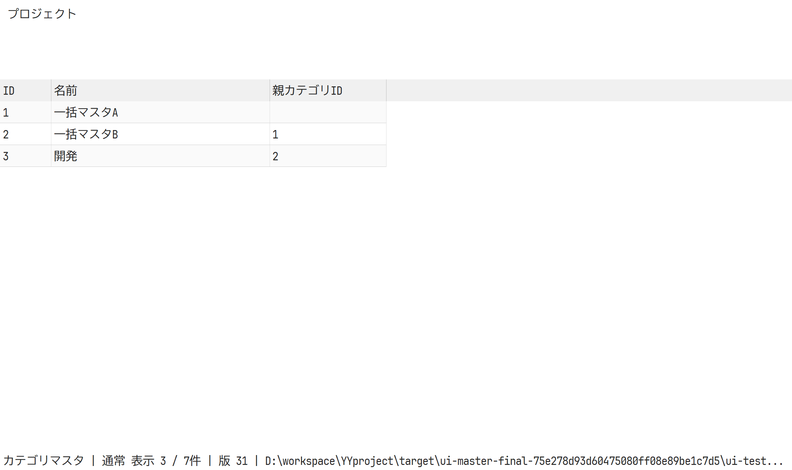
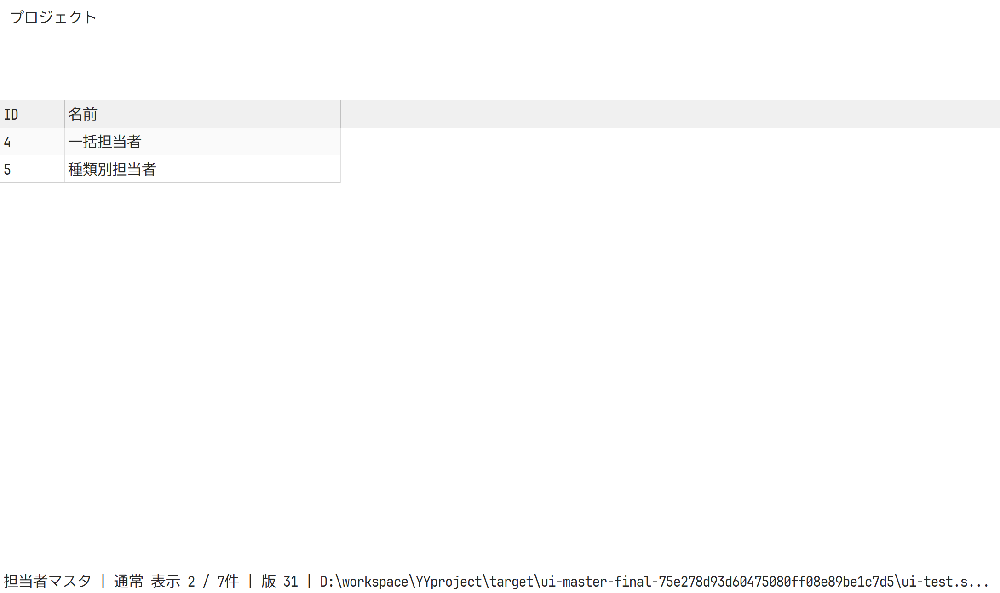
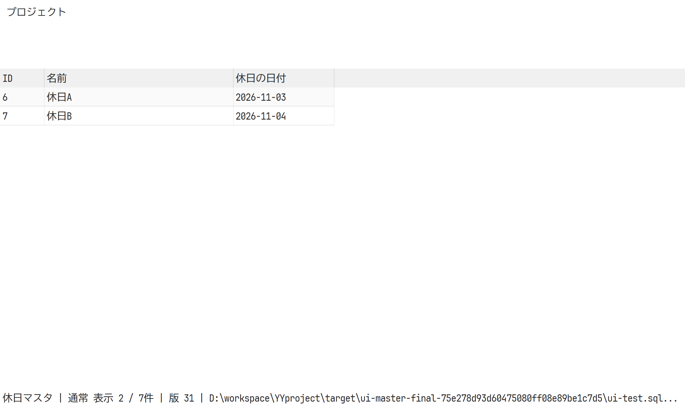
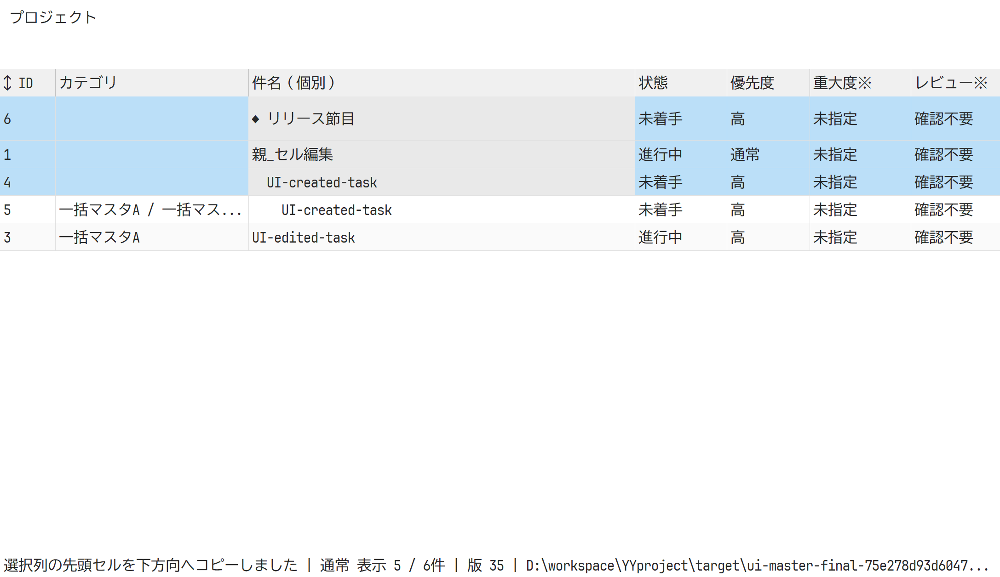
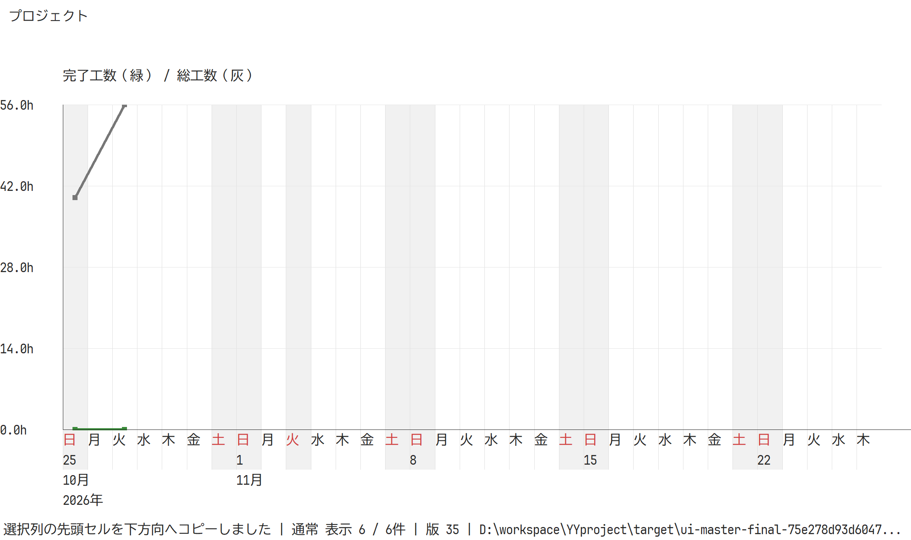

# 種類別マスタ・同列コピー・逆順日付軸（2026-10-27）

## 変更内容

マスタにカテゴリ・担当者・休日の子タブを設け、選択した種類だけを表示する。列はカテゴリがID／名前／親カテゴリID、担当者がID／名前、休日がID／名前／休日の日付とし、種類のセルは表示しない。描画・選択・編集・コピー・貼り付けは可視行のIDで参照する。切替時は編集の検証後に選択・スクロールを解除し、表示件数も選択した種類で数える。

個別セルの編集可否と複数行の変更可否を分離した。一括変更可能な属性は担当者・カテゴリ・状態・優先度・開始日・期限・完了日・進捗に限定する。件名には「個別」、他の個別編集専用列には※を表示する。複数行での該当セルは灰色にし、一括上書き・消去・貼り付けを拒否する。複数行から項目編集を開いた場合も、件名を含む個別フォームを開かない。

Ctrl+D・編集メニュー・タスクの右クリックメニューで、選択した各列の先頭値を下へコピーできる。同列への1セル貼り付けも選択範囲へ展開する。タスクの参照マスタはIDでコピーし、同名の担当者がいても取り違えない。可視順の先頭選択行がコピー元で、未選択行・非表示行は変更しない。不正な参照・循環・完了条件への違反は全体を保存しない。

バーンダウン／バーンアップの日付軸を上から曜日・日・月・年の4段に変更した。曜日は日次、日の数字は起点から7日ごと、月・年は境界に表示する。日次格子・太い実績線・休日背景を維持する。

## 検証

利用中のデモDBは変更せず、前回と同じ検証用ソースコピーとGit管理版のデモDBを使用した。試験の除外・ignore・警告allowは追加していない。

- Windows: fmt、Clippy -D warnings、全28テスト、リリースビルド、実stdio MCPが成功。
- Linux: Dockerのrust:1.92-bookwormでfmt、Clippy、全27テスト、ビルド、実stdio MCPが成功。GUIはWindows専用であり、Linuxでは検証していない。
- Windows GUI: 実DPI192・実クライアント・スクロール座標を使い、SQLiteと専用PostgreSQLの両方で終了コード0。所有ウィンドウ・専用DBを用い、期限60秒でプロセスを終了確認・回収し、固定sleepは使わない。
- 子タブのTCN_SELCHANGEを通して3種類を切り替え、可視ID・件数・必要列を確認。休日の日付コピーが他の種類を変更しないこと、1セル貼り付けの範囲展開、選択列のコピー、件名への複数行編集・貼り付け拒否と無更新を確認。
- core試験で同名担当者のID保持、コピー元・未選択行の保持、個別専用列の拒否を確認。
- SQLite GUIログ: target/ui-master-final-75e278d93d60475080ff08e89be1c7d5/ui-smoke.txt。
- PostgreSQL GUIログ: target/ui-master-final-postgres-f9b8a98984a84f69af8185c23e2b71d1/ui-smoke.txt。試験後は今回作成したyyproject_master_fill_gui_20261027だけを削除した。

依存の固定SHAとDB形式4は変更していない。GitHub CIの実行・成功確認はしていない。配布ZIPを更新し、同梱バイナリの一致・全項目CRC・Git管理版デモDB・ライセンス通知・秘密設定の除外を確認した。

## 描画記録

本番キャンバスの描画。子タブなどネイティブ子コントロールは画像に含まれず、上記の実ウィンドウ試験で確認した。

