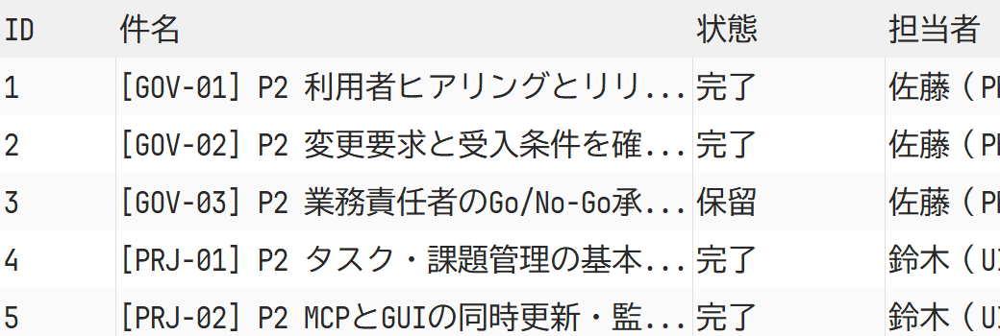
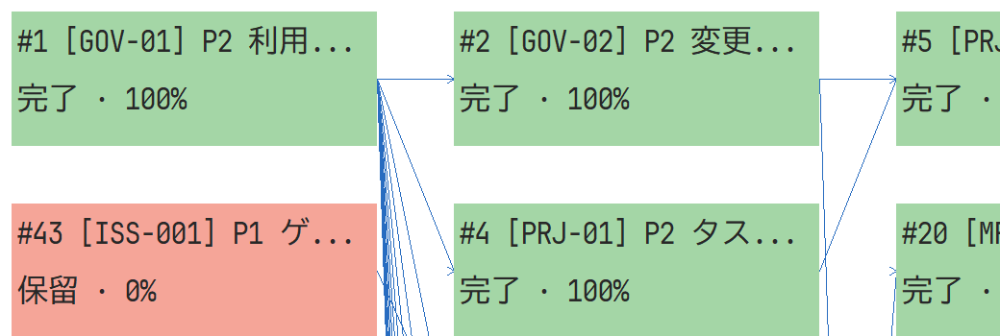
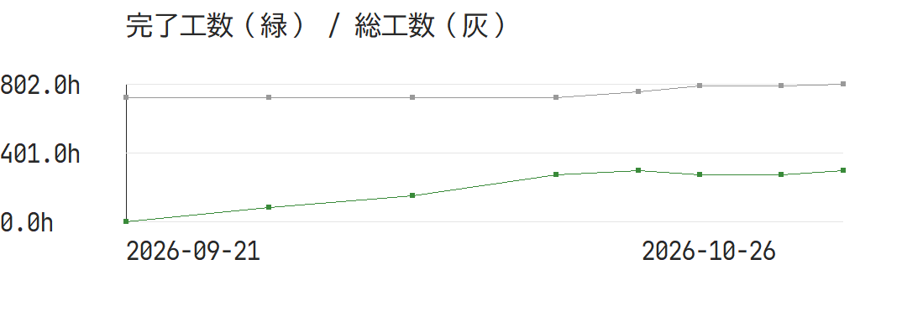

# YYprojectの運用シナリオ検証（2026-10-26）

## 結論

SQLite保存、日々の項目更新、案件切り替え、MCPによる参照・更新の基盤は動く。版による更新競合、不正な担当者参照、依存の循環、読み取り専用での更新を拒否できた。

一方、**複数案件・兼務・納期・承認を伴うチーム運用を、この画面とデータモデルだけで完結するのはまだ難しい**。主案件64項目、全体90項目で、期限超過・未割当の発見、担当者負荷、完了条件、再計画の根拠を外部台帳や件名・説明の代替表現に頼る。描画成功と業務運用の合格を区別する。

ここは日付付きの実測記録。現行の操作は[デモ案内](../../../demo/README.md)、再現方法は[開発ガイド](../../developer/yyproject.md)。基準は未コミットの変更を含む作業ツリー（基点 `0da9e0ecd2f4315974466c26cd697ed52e00ed68`）。DBとシナリオのSHA-256は証拠JSONに記録した。後の修正済み版と混同しない。

## 題材と方法

- 安定化リリース: 48タスク・16課題、8時点の履歴。追加要求、再見積もり、差し戻し、中止、外部待ち、承認待ちを含む。
- 緊急保守: 12タスク・4課題、3時点。同じSSH・QA・運用担当者を使う。
- 前回リリース: 8タスク・2課題、全件完了。案件切り替えと参照に使う。
- 原本は[scenario.json](../../../demo/scenario.json)。架空の人物・計画・障害であり、実際のYYシリーズの状態ではない。
- 実MCPプロセスで、ケースごとに異なるコピーDBへ変更を適用した。[Windowsの全証拠](evidence/yyproject-operations-windows.json)。10の不足と2群の整合性保護を確認した。
- Windows GUIはDPI192、1100×700／640×480で、3案件×8画面×2サイズの48条件を検証した。[描画範囲・件数・単回時間](evidence/yyproject-operations-ui.json)。画像は実際のキャンバス描画の切り出しで、ネイティブのメニューや子コントロールは含めない。
- 長時間入力中の競合回復、実業務担当者による探索時間・理解度、複数人の長期間利用は未実施。[手動チェックリスト](../../../demo/acceptance-checklist.md)に残した。

## 実行結果

Windows x64／Rust 1.99.0 MSVCとLinux x64／Rust 1.99.0 bookwormコンテナで、fmt、全ターゲットClippy、コア6試験・MCP/デモ4試験、リリースビルド、実stdio MCPが成功した。運用シナリオは両OSとも2群の保護と10のgapを同じDB・シナリオSHAで確認した。[Linuxの全証拠](evidence/yyproject-operations-linux.json)。GUI48条件はWindowsでのみ実行した。

これはYYprojectの運用モデルと表示の検証であり、題材にした各YYアプリの実機接続や編集機能を再検証したものではない。

## 優先して改善する課題

| 優先度 | 論点 | 再現した状態 | 改善の方向 |
| --- | --- | --- | --- |
| P1 | 会議で必要な項目へ辿れない | 期限超過19件、未割当3件があるが、GUIに担当・期限・優先度等の絞り込み/並べ替えがない | 保存ビュー、全文検索、期限超過/未割当一覧、列選択・幅変更・折り返し |
| P1 | カンバンの初期表示を空と誤認する | 全10項目が完了の案件で、DPI192・1100×700でも表示カード0件。完了列が画面外 | 列幅の調整、状態の件数表示、列へのジャンプ、空である理由の表示 |
| P1 | 残作業と完了/承認が曖昧 | done→doingでも100%のまま保存でき残工数0。review状態や承認者の専用項目がない | 作業完了・確認待ち・承認完了の区別、再開時の再見積もり、確認者/理由 |
| P1 | 依存は業務の完了ゲートにならない | SSH-02が保留でもSSH-03を完了にできる | 警告/強制の方針、例外承認、保留理由と解除条件 |
| P1 | 再計画で元の意味が失われる | 休日追加後の再計算で完了項目15件の日程が変わる。納期超過の計画も保存できる | 基準計画・現在計画・実績日、固定項目、差分プレビュー、納期警告 |
| P1 | 兼務と稼働上限を反映できない | 2案件で同じ担当者を使用。机上配分で最大27.6h/日対上限6h/日 | 共通担当者ID、稼働率/個別休暇、案件横断の残作業と負荷、平準化の方針 |
| P1 | 全体図・日程の見通しがない | ネットワーク3220×4600に対し表示1040×350。小画面ガントは固定の項目名を除くと数日分 | 全体表示・ズーム、週/月粒度、重要経路/保留原因へのフォーカス |
| P2 | 課題の扱いが作業タスクと同じ | 課題へ8h入力すると総工数も8h増える。重大度・確認者・関連種別は件名/説明で代用 | 課題と対応作業の関連、二重計上防止、型別の項目・集計対象 |
| P2 | 履歴補正と削除の業務統制が弱い | 過去captureを現在値で置換でき、削除で依存も消える。専用復元ツールなし | 締め・訂正理由・アーカイブ・影響確認・復元 |
| P2 | 案件/項目の業務情報が構造化されない | 共通担当者、案件の完了/アーカイブ、コメント、論理的な関連、正式な承認の表現が不足 | プロジェクト/課題モデルと権限・承認範囲を先に定義 |

P1はこの題材のチーム運用を始める前に方針・対策を決めたい事項。すべてをプログラムの不具合と断定していない。たとえば依存は現仕様で日程用、captureは明示置換として公開されており、今回の業務要求との隔たりである。

## 実画面で分かったこと

### 一覧の情報密度



DPI192では内容幅2200pxに対し表示1040px。担当者の途中までしか見えず、期限・進捗・工数を同時に確認できない。長い件名も省略される。640×480では表示幅580px・高さ130pxで、ヘッダーを除くと一部表示を含む2項目程度。閲覧と編集を分けた詳細ペイン、折り返し/行高、列固定・カスタマイズ・絞り込みが必要。

### 完了案件のカンバン


DBには完了10項目があるが、この初期表示のヒット領域は0件。横スクロールすれば表示されるためデータ欠損ではない。全体幅2400pxと現在位置の関係が分かりにくく、誤認を招く。

### 依存ネットワーク



主案件64項目の全体に対し見えるのは6つのヒット領域。長い件名の先頭以外が省略され、画面外へ伸びる線の相手を追いにくい。ズーム/全体表示、選択項目の先行・後続だけの表示、重要なゲートの強調が必要。

### 進捗チャート



追加要求で総工数が増え、差し戻しで完了工数が減る実データを表示できた。中止でも集計が変わる。今のグラフには出来事の注釈・元計画線・補正理由がないため、線だけで遅延原因や承認状況を判断できない。履歴は集計値だけで、過去の担当・期限・項目全体へGUIで戻ることもできない。

## 使える範囲と実装順序

現段階は、個人または小規模チームの項目記録・説明追記・進捗共有を、外部の計画/承認/稼働台帳と併用する用途。正式なリリース判定や納期・人員配置の根拠を単独で担わせる段階ではない。

1. 誤認しやすい表示（完了列、絞り込み、情報密度、全体図）を先に直す。
2. 状態・残工数・承認と、計画/実績/変更履歴のモデルを決める。
3. 共通担当者・稼働率・個別休暇・案件横断負荷と納期影響を扱う。
4. 課題固有の項目/関連、過去訂正、アーカイブ/復元を整える。

業務ルールの判断を要するため、この検証で全部の制約を一律に強制したり、デモだけの例外で回避したりしていない。安全性の試験を通すことと、これらの不足を直すことは別の作業。

## 再現

```powershell
cargo test --workspace --locked
python tools/test_mcp.py target/release/yyproject.exe
python tools/validate_operations.py target/release/yyproject.exe
./target/release/yyprojectw.exe --ui-smoke-test target/new-ui-evidence-directory
```

Linuxは.exeを外す。GUIはWindows専用。CLI生成と検証は元DBではなく、新規生成またはコピーだけを更新する。GitHub CIは今回の未コミット変更では未実行。ローカルの結果と区別する。
