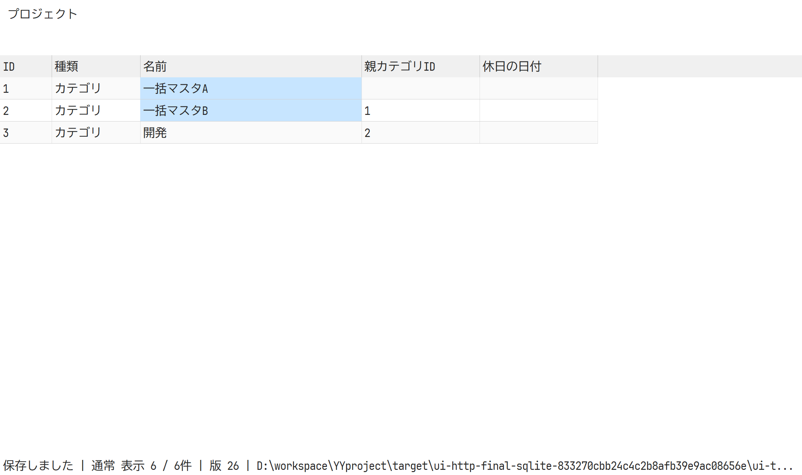
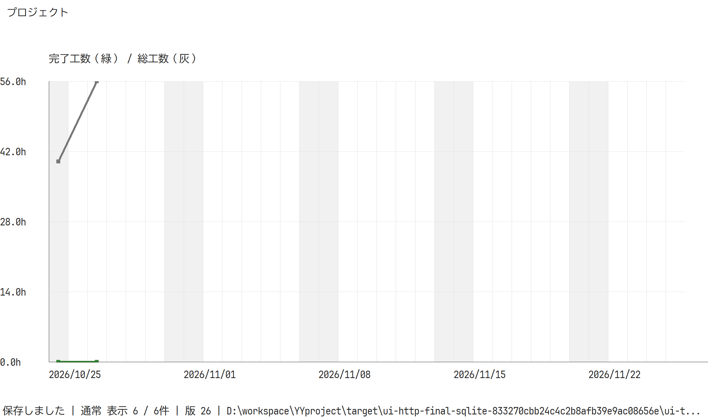
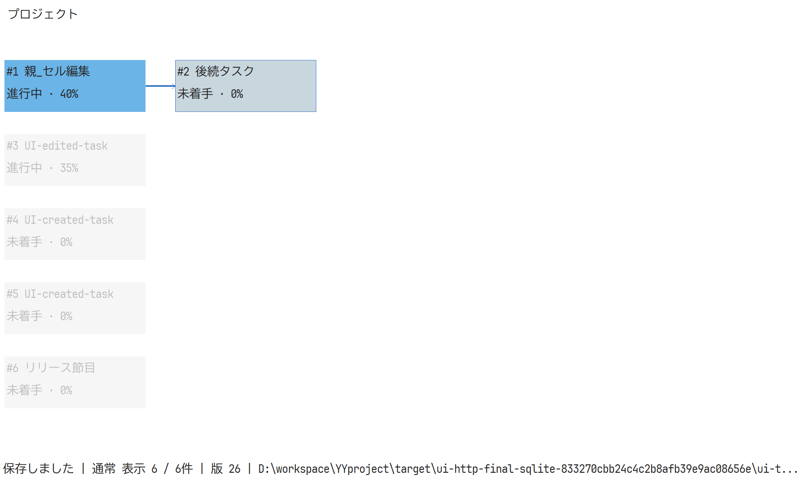
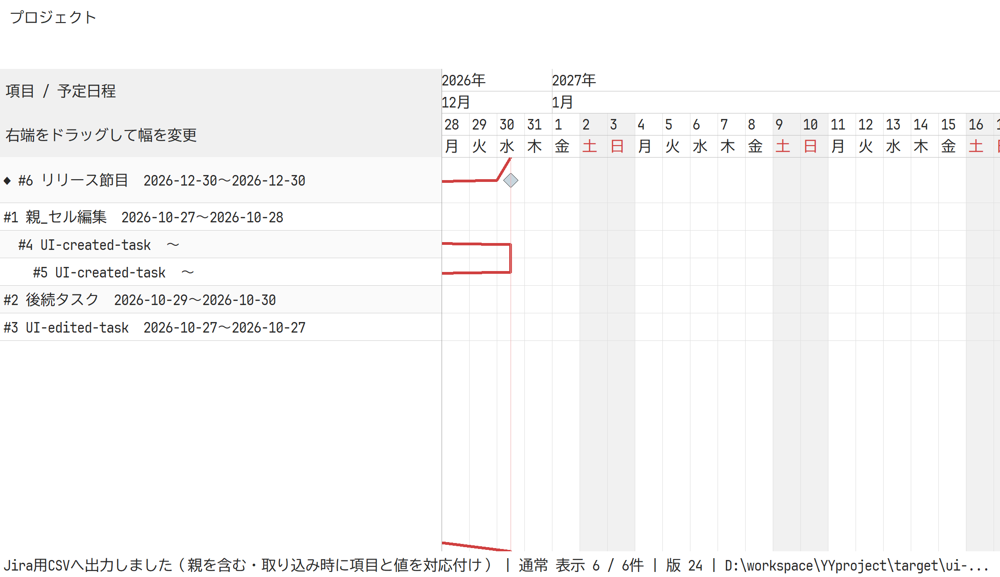
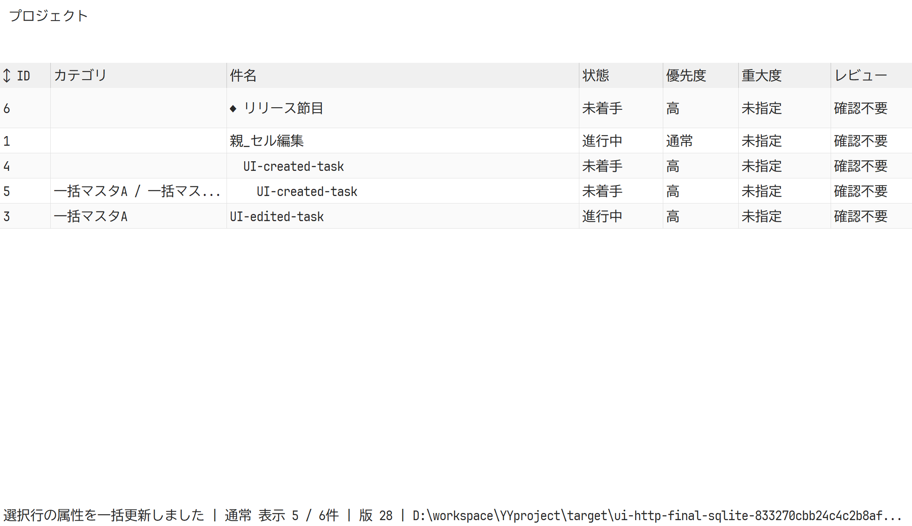

# 一覧編集・日次表示・Streamable HTTP/PATの検証（2026-10-27）

## 実装

- マスタをセル一覧へ変更。F2/Enter/Tab/Esc、矩形コピー、一括貼り付けに対応し、SaveMastersで参照・階層を検証して原子的に保存する。
- タスク／課題一覧とマスタの列境界・行境界、ガントの名前列・行境界・日付列境界をドラッグ可能にした。DPIとスクロールを使い、Esc・右クリック・キャプチャ喪失で元の寸法へ戻す。寸法はウィンドウの表示状態とし、DBを更新しない。
- タスクの範囲行・Ctrlによる非連続行を選択し、担当者・カテゴリ・状態・優先度・開始日・期限・完了日・進捗を一括変更するフォームを追加。右クリックと編集メニューから開き、変更しない属性を維持する。事前検証・版競合・一括保存・監査は共通モデルを使う。
- Task.completed_onを実績完了日として追加。状態と予定期限とは独立し、一覧・フォーム・CSV・MCP・DB移送で保持する。形式4に更新し、旧形式の読み取りと成功した書き込み時だけの版更新を維持した。
- バーンダウン／バーンアップを日次格子、7日ごとの日付、ガントと同じ休日背景にした。長い期間は横スクロールする。チャートと稲妻線は3論理pxの太さにした。
- 依存ネットワークは選択項目の先行・後続だけを強調し、他を薄くする。同じ祖先から分岐するだけの別系統は含めない。
- CLIにStreamable HTTPの/mcp、PAT生成、TOMLのユーザー設定を追加。PATはOS乱数256bit、設定にはSHA-256ハッシュだけを保存する。ユーザー・PATの変更は毎要求で再読込し、セッションをユーザーとPATへ結び付ける。HTTPの監査actorは認証名に固定し、ユーザー／サーバーの読み取り専用を強制する。
- HTTPはJSON応答・通知202・GET405・DELETE204を実装し、Host/Origin、プロトコル版、セッション、本文2MiB、読取期限、同時要求・セッション数を検査する。stdioとSessionを共有し、同期DB処理は非同期ランタイムから分離する。

操作: [一覧・チャート](../../user/yyproject.md)、[HTTPとPAT](../../user/mcp-http.md)。追加20パッケージと再利用する実行時依存のライセンス32件をHTTP通知へ記録し、Cargo.lockを更新した。yy-ui-winの固定SHAは変更していない。

## 検証方法と結果

利用中のdemo/yyproject-demo.sqlite3に独自の履歴が追加され、固定デモの履歴8件を検査する試験は9件との差で失敗した。利用者DBには触れず、target/ui-polish-sourceへ全ソースの検証用コピーを作り、デモDBだけGit管理版をコピーした。試験の除外・ignore・警告allowは追加していない。配布物にも利用者のデモDBを入れず、同じGit管理版を使用する。

Windows:

- 検証用コピーに対しcargo fmt --all -- --check、cargo clippy --workspace --all-targets --locked -- -D warnings、cargo test --workspace --lockedが成功。テスト27件（core 19、CLI 7、GUIの純粋ロジック1）。出力先はtarget/polish-validation。
- リリースをtarget/kanban-buildへ出力。実stdio MCP、PATの生成・ハッシュ保存・更新・失敗時のロック回収を確認。
- tools/test_http.pyの実HTTPで初期化、通知、ツール一覧・実行、終了、未知セッション、PAT更新・削除、別ユーザーのセッション拒否、actor偽装防止、読み取り専用、同時更新競合、HTTPヘッダー、Origin/Host、不正JSON、本文上限、不正設定時の拒否を確認。SQLiteと専用PostgreSQLの両方で成功。
- tools/test_postgres.pyでマスタ一括操作、実績完了日、監査全件、競合、原子的失敗、SQLiteへの往復移送を確認。
- 実GUIは専用DBと所有ウィンドウを使い、実DPI192・実クライアント領域・実スクロール座標から操作。60秒の期限でプロセスを回収し、固定sleepは使わない。F2/Enterのマスタ保存、コピー、失敗した貼り付けの無更新、列・行境界のドラッグ、スクロール後のEsc復元、2行だけの属性更新・版1回、非連続行の選択解除、既存のカンバン・ガント・CSV・Jira出力を確認。
- 最終SQLite GUIログ: target/ui-http-final-sqlite-833270cbb24c4c2b8afb39e9ac08656e/ui-smoke.txt。
- 同じGUI・モデルのPostgreSQLログ: target/ui-polish-final-postgres-d34f2d74fbb745d283dd929ea2f0a383/ui-smoke.txt（HTTP依存追加前）。

Linux:

- rust:1.92-bookwormのDockerで同じ検証用コピーに対するfmt、Clippy、テスト26件（Windows専用GUIテストはコンパイル対象外）、ビルド、実stdio MCPが成功。
- SQLiteと専用PostgreSQLの両方でtools/test_http.pyが成功。PostgreSQLの同期クライアントを含む実リクエスト処理も確認。
- マスタと完了日の移送はtools/test_postgres.pyでも確認した。LinuxではGUIを検証していない。

HTTP試験は起動ログを期限付きで待ち、起動したプロセスだけを終了・回収した。本番のPAT・ユーザー設定は生成していない。検証用DBは利用者用yyprojectとは分離し、今回作成した5個だけを試験終了後に削除した。Composeはhealthyのまま維持した。

配布ZIPは実行ファイルのバイト一致、Git管理版デモDBとの一致、全項目CRC、HTTP依存通知・説明書・試験スクリプトの同梱、.envとPAT設定の除外を確認した。検証コピーと元のRustソース・Cargo.lock・埋め込みヘルプのバイト一致も確認した。

GitHub CIへHTTP試験を追加したが、最新SHAのCI実行・成功確認はしていない。外部ネットワーク・HTTPSリバースプロキシ・別DPIの実機・実際のJira取り込みは未検証。

## 描画確認

画像は本番キャンバスの描画。ネイティブのタブ・フォームなど子コントロールは含まれず、上記の実ウィンドウ操作で別に確認した。

